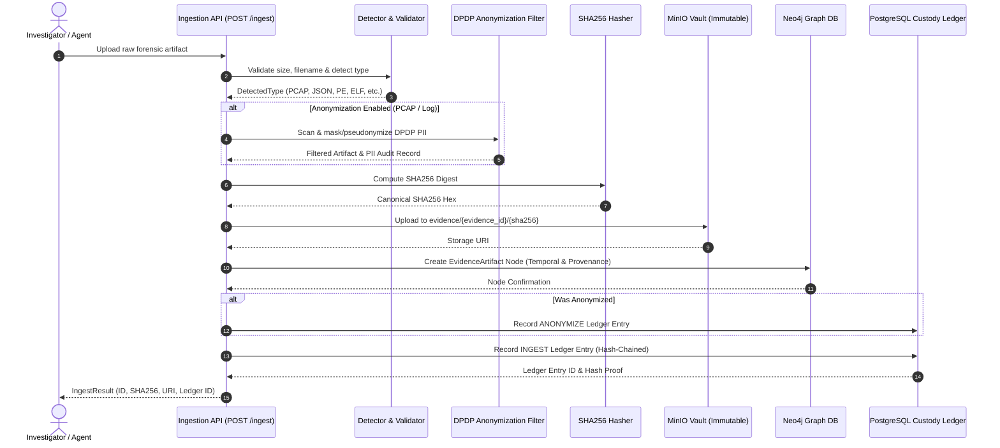

# Forensic Artifact Ingestion Subsystem Overview

## 1. Introduction

The **Ingestion & Chain of Custody subsystem** constitutes the secure front door of EvidenceGraphAI. It accepts heterogeneous forensic artifacts (such as network packet captures, vulnerability records, compiled malware binaries, Android APKs, forensic logs, and cryptographic certificates), validates format and structure, assigns unique identifiers, computes canonical cryptographic digests at first contact, securely stores the artifacts in immutable object storage, registers the evidence entity in the knowledge graph, and maintains an unbroken, tamper-evident chain of custody ledger aligned with legal admissibility requirements.

---

## 2. Ingestion Lifecycle & Architecture

The ingestion pipeline is designed around a strictly ordered, idempotent, and atomic workflow:

---

## 3. Core Modules

| Module | Location | Purpose |
| :--- | :--- | :--- |
| `ArtifactIngestor` | [`core.ingestion.ingestor`](file:///d:/EvidenceGraphAI/core/ingestion/ingestor.py) | Main pipeline orchestrator coordinating validation, storage, graph creation, and ledger logging. |
| `FileTypeDetector` | [`core.ingestion.detector`](file:///d:/EvidenceGraphAI/core/ingestion/detector.py) | Multi-layered file type detector using magic bytes, MIME, and deep structure analysis. |
| `Hasher` | [`core.ingestion.hasher`](file:///d:/EvidenceGraphAI/core/ingestion/hasher.py) | Streaming, memory-safe SHA256 cryptographic digest computation. |
| `Validators` | [`core.ingestion.validators`](file:///d:/EvidenceGraphAI/core/ingestion/validators.py) | File size limits, filename sanitization, and allowlist validation. |
| `MinioClient` | [`core.storage.minio_client`](file:///d:/EvidenceGraphAI/core/storage/minio_client.py) | S3-compatible client with deterministic collision-resistant object keying. |
| `CustodyLedger` | [`core.custody.ledger`](file:///d:/EvidenceGraphAI/core/custody/ledger.py) | Append-only PostgreSQL table with database-level immutability triggers. |
| `ArtifactVerifier` | [`core.custody.verifier`](file:///d:/EvidenceGraphAI/core/custody/verifier.py) | On-demand cryptographic recomputation and ledger comparison service. |
| `DPDP Filter` | [`core.privacy`](file:///d:/EvidenceGraphAI/core/privacy) | Indian DPDP Act 2023 compliant PII scanner and anonymizer (MASK/PSEUDONYMIZE/REDACT). |
| `ManifestGenerator` | [`core.custody.manifest`](file:///d:/EvidenceGraphAI/core/custody/manifest.py) | Section 65B Indian Evidence Act certified manifest producer and digital signature validator. |

---

## 4. Failure Modes & Atomicity

Forensic integrity requires that partial ingestion never leaves unrecorded artifacts or orphaned nodes:
1. **Validation Rejection:** Malformed, unsupported, or oversized files are rejected with HTTP 400/413 before storage.
2. **Storage Failure:** If MinIO upload fails, no graph nodes or ledger entries are recorded.
3. **Graph Registration Failure:** If graph node creation encounters an error, a compensatory `ERROR` entry is logged in the custody ledger to record the anomaly.
4. **Ledger Append Failure:** If the custody ledger append fails, the operation raises an `IngestionAtomicityError` ensuring no untracked artifacts can be treated as valid evidence.
