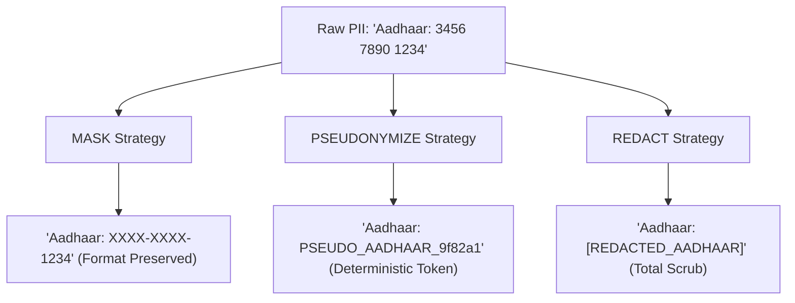

# Privacy Anonymization Methods & Investigative Tradeoffs

## 1. Supported Transformation Strategies

[`Anonymizer`](file:///d:/EvidenceGraphAI/core/privacy/anonymizer.py) provides three configurable transformation methods:

---

## 2. Strategy Breakdown & Tradeoffs

### 1. `MASK` (Masking)
- **Transformation:** Obfuscates sensitive middle characters while retaining last 4 digits (e.g. `XXXX-XXXX-1234`, `AXXXXXX12A`, `u***r@domain.com`).
- **Investigative Benefit:** Allows investigators to cross-reference partial records or confirm account ownership without exposing the entire secret identifier.

### 2. `PSEUDONYMIZE` (Pseudonymization)
- **Transformation:** Replaces PII with an HMAC-SHA256 salted hash digest token (e.g. `PSEUDO_EMAIL_3a9f821c`).
- **Investigative Benefit:** Provides complete privacy protection while allowing cross-case graph correlation: two separate investigations involving the same pseudonymized identity can still link to the same entity node in Neo4j.

### 3. `REDACT` (Redaction)
- **Transformation:** Completely replaces target PII with a descriptive category tag (e.g. `[REDACTED_AADHAAR]`).
- **Investigative Benefit:** Highest privacy guarantee; suitable for public judicial exhibits or external intelligence dissemination.
